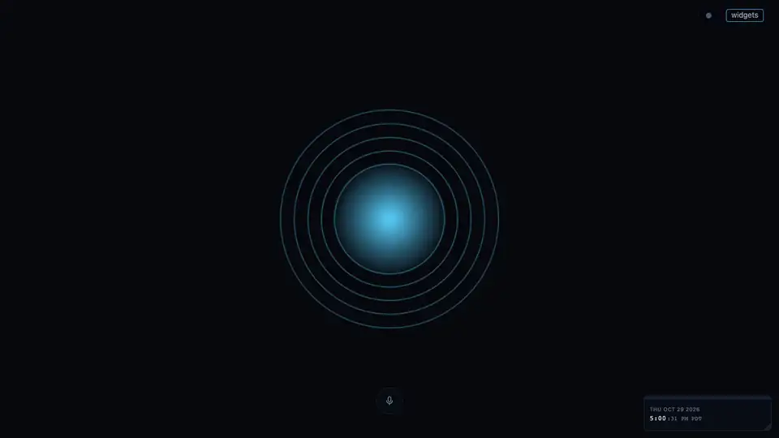
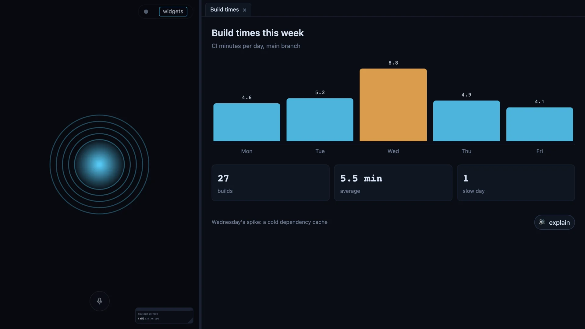
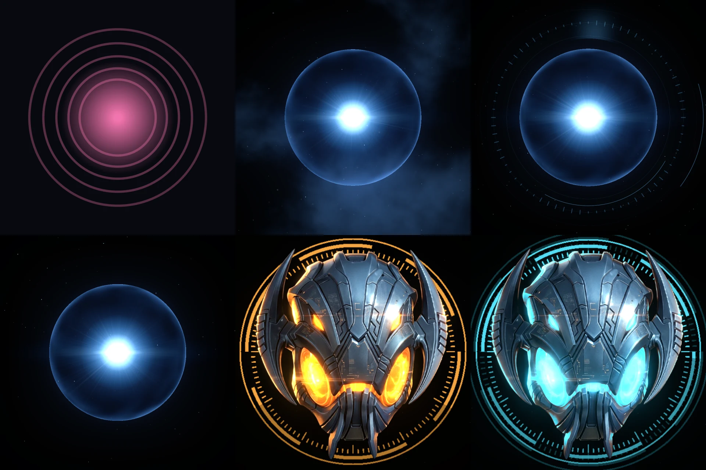

# agent-orb

A voice window for Claude Code and GitHub Copilot CLI, on Windows and macOS. Hold a button and talk; the agent's
reply is read aloud in a local voice; ask it to show something and an HTML panel slides in beside the orb.

With the built-in engines, speech never leaves the machine: Moonshine turns your voice into text and Kokoro speaks
the reply. Moonshine runs on the CPU; Kokoro uses an NVIDIA GPU when the machine has one that loads, and the CPU
otherwise. An engine you add yourself may be a cloud service; see [Speech engines](#speech-engines).

<p align="center">
  
</p>

- [What you get](#what-you-get)
- [Install](#install)
- [First run](#first-run)
- [Everyday use](#everyday-use)
- [Where your things live](#where-your-things-live)
- [Config](#config)
- [Panels](#panels), [Widgets](#widgets), [Skins](#skins), [Themes](#themes)
- [Speech engines](#speech-engines), [Wake word](#wake-word)
- [Troubleshooting](#troubleshooting), [Uninstall](#uninstall), [Developing](#developing)

## What you get

- **Push to talk**: hold the button, or Space with the window focused, and speak; the reply is read aloud.
- **Local speech**: the built-in transcription and voice run on your machine. An engine you add yourself can change that.
- **Voice and speed**: pick the speech engine and its voice from the bar, set the speed with a slider; saved per repo.
- **Mute and stop**: `M` silences replies without closing the orb; `Escape` ends the speech or the agent's turn.
- **Talk while it works**: status, repeat and "what did I miss?" are answered at once; anything else waits for the turn to end.
- **Transcript**: every exchange, typed or spoken, with the agent's steps folded in (`T`).
- **Panels**: ask the agent to show something and a page slides in beside the orb, with tabs, explain buttons and live data from your own feeds.
- **Widgets**: small pages of your own floating over the orb, such as a clock or a usage meter.
- **Skins and themes**: change how the orb looks (`B` cycles skins) and how everything around it is styled.
- **Wake word**: optional hands-free start, which can answer your enrolled voice only.
- **Your own engines**: plug in any speech-to-text or voice engine as a folder.

## Install

### Prerequisites

You need `uv`, `node` 24 or later, and Chrome.

- **Windows**: `winget install astral-sh.uv OpenJS.NodeJS.LTS Google.Chrome`
- **macOS** (with [Homebrew](https://brew.sh)): `brew install uv node` and `brew install --cask google-chrome`

Python and the speech models are fetched on the first open; nothing else to install by hand.

### Claude Code

Claude Code 2.1.275 or later installs it in one step:

```
/plugin install agent-orb --marketplace NerdoBaggins/agent-orb
```

On an older Claude Code, add the marketplace first, then install:

```
/plugin marketplace add NerdoBaggins/agent-orb
/plugin install agent-orb@nerdobaggins
```

Then start Claude Code with the channel flag, every time you want the orb:

```
claude --dangerously-load-development-channels plugin:agent-orb@nerdobaggins
```

**What the flag does.** A plugin's MCP server normally only answers the agent; a *channel* may also push messages
into the session, which is how your speech reaches Claude Code. Channels are a research preview, so Claude Code
asks you to confirm the flag at every start. The channel named here is this plugin's own (`channel/orb-channel.mjs`,
registered by its `.mcp.json`, no npm dependencies). It listens on `127.0.0.1` only, makes a fresh random secret
each time the session starts, and refuses any request from a browser or without that secret. The secret is written
to this repo's state folder under `~/.config/orb/`, readable by you only, which is where the orb server on this
machine picks it up. Without the flag the orb opens but reports **Not attached**.

### Copilot CLI

Install from the same marketplace:

```
copilot plugin marketplace add NerdoBaggins/agent-orb
copilot plugin install agent-orb@nerdobaggins
```

Then start Copilot in the repo you want the orb for, with its experimental mode on:

```
copilot --experimental
```

A default Copilot loads a plugin's extensions only in experimental mode, and the orb reaches Copilot through one. To keep it on,
run `/experimental on` inside Copilot once: it saves the mode in Copilot's settings, and a plain `copilot` is then
enough.

**How the orb reaches it.** The plugin carries a Copilot extension (`extensions/orb/extension.mjs`, no npm
dependencies). Copilot starts it with each session and joins it to that session over a private pipe, so Copilot
itself opens no port. The extension then opens the orb's way in, on the same terms as the Claude Code channel: it
listens on `127.0.0.1` only, makes a fresh random secret each time it starts (after `/clear` too), and refuses any
request from a browser or without that secret. The secret is written to this repo's state folder under
`~/.config/orb/`, readable by you only, which is where the orb server on this machine picks it up.

Working on the orb itself? Load it from a checkout instead: see [Developing](#developing).

### Several Copilots at once

Copilots in different repos need nothing: each repo has its own state folder, so each orb finds its own Copilot.
One orb per agent per repo, so two Copilots in the same repo share one orb.

Coming from 0.4.0? A shell function that starts `copilot --ui-server --port …` or sets `ORB_COPILOT_PORT`, as the
0.4.0 README suggested, is no longer needed: drop both, or the uncredentialed UI server keeps running beside the orb.

## First run

In either agent, say or type *"open the orb"*. The agent runs `orb open`, and a window opens in a browser profile of
the orb's own.

- **The first open is slow.** Python dependencies install themselves and the speech models (about 400 MB) download
  once; later opens take seconds.
- **The browser asks for the microphone** once per repo and agent, since each has its own port. The orb reuses that
  port on every later open, so the permission sticks, unless something else has taken it in the meantime.
- **Talk:** hold the round button, or hold Space while the window has focus, and speak. Release to send. The reply is
  read aloud and shown under the orb.

There is one orb per agent per repo. Opening it again while it is running reopens its window if you closed it;
otherwise it prints the open orb's address.

### The bar

A faint pill in the top-right corner (of the orb's side when panels share the window) shows a dot in the orb's state
colour, the wake word when one is on, a count of replies you missed, and what the agent is running in the
background. Hover it to open the rest:

| Control | What it does |
|---|---|
| Session name | the session the orb is attached to (Claude Code's `/rename` name, Copilot's session name), following a rename within a few seconds |
| Transcript | shows or hides the transcript (`T`) |
| Voice | mutes or unmutes speech (`M`) |
| Speed | the voice speed, from 0.7 to 1.6 |
| Size | the orb's size, marked at normal; each skin keeps its own |
| Hearing | every installed transcription engine; switching loads it at once |
| Speech | every installed voice engine; switching loads it at once |
| Voice menu | the current engine's voices, when it offers them; each engine keeps its own choice |
| Skin | every installed skin (`B` cycles them) |
| Theme | every installed theme |
| Widgets | ticks your installed widgets on or off |

Everything you change here is saved for this repo only.

### Keyboard shortcuts

They work while the orb window has focus and you are not typing in a text field.

| Key | What it does | Config key |
|---|---|---|
| `Space` (hold) | push to talk | `ptt_key` |
| `M` | mute or unmute | `mute_key` |
| `T` | show or hide the transcript | — |
| `B` | next skin | `skin_key` |
| `P` | hide the open panels, and bring them back as they were | `panels_key` |
| `Escape` | restore the orb and panels split; otherwise stop the speech or the agent's turn | — |

A skin can add keys of its own for its options.

### The window

With no panels, the orb has the whole window. With panels open, the orb takes about a third of it:

- Drag the divider to resize; dropped near an edge, it gives that side the whole window.
- Double-click the orb and it takes the whole window. Double-click a panel's tab and that panel does, with the orb out
  of sight and a dot in the bar carrying its state. Either again, or `Escape`, restores the split.

## Everyday use

**The orb follows the session, not just its own requests.** A turn typed in the terminal shows as working, with the
step it is on, and its reply is spoken too, as is the one the agent gives when a background task it started
finishes. The transcript lists everything: what was typed (in the orb or the terminal), what the agent said, and the
steps between them folded into one line.

**Replies you missed.** A reply that finishes while the window is unfocused counts as new, spoken or not: a badge
shows in the bar and the title, cleared when you look at the window, and "what did I miss?" reads them aloud.

**Talking while it works.** While the session is busy, the orb answers repeat, status and "what did I miss?" itself,
and holds anything else to send as your next request when the turn ends.

**Muting.** The `voice` button in the bar or `M` mutes the orb: speech stops at once, nothing is rendered while
muted, and a reply that arrives muted is not read on unmute.

**Closing.** Closing the window ends the orb: the server exits 20 seconds after its last window goes, and `orb stop`
ends it at once. The window keeps the outcome of your last try (what it heard, or why it could not listen) until the
next one.

### Commands

You rarely type these; the agent runs them as `uv run --project <agent-orb> orb ...`, where `<agent-orb>` is the
plugin's folder (the skill tells the agent where that is).

| Command | What |
|---|---|
| `orb open [--agent claude\|copilot]` | start this session's orb server and window (one per agent per repo), on the same port every time |
| `orb stop [--agent claude\|copilot]` | stop this repo's orb and close its window at once |
| `orb panel show <file.html\|name\|transcript> [--title] [--name]` | show a panel |
| `orb panel close <name>` | close one |
| `orb panels list` | saved panels |
| `orb widgets list` | installed widgets, with their scope, which are on, and which names are also panels |
| `orb widget on\|off <name>` | show or hide one of your widgets over the orb, saved for this repo; with no orb open, sets it for the next one |
| `orb voice on\|off\|toggle [--agent claude\|copilot]` | mute or unmute the orb's speech without closing it; with no orb open, sets it for the next one |
| `orb voice enroll [--agent claude\|copilot]` | enroll your voiceprint in the open orb (five phrases, hold to read) |
| `orb log [-n N] [--agent claude\|copilot]` | the newest lines (60 unless you say) of this repo's orb log |
| `orb doctor [--no-engines]` | read-only checks: tools, browser, config, skin, theme, actions, widgets, agent links, engines, wake word |

Every command also takes `--repo <path>` to act on another repo than the current one.

## Where your things live

Everything works with no setup: the default folders below are found automatically. The `*_dirs` settings are
optional extra folders you name in your config, for example a synced folder shared between machines.

`~` is your home folder (`%USERPROFILE%` on Windows). `<repo id>` is the repo's folder name plus a short hash;
`orb panels list` prints this repo's folder on its first line.

| What | This repo only | Every repo | Extra folders you name | Built in |
|---|---|---|---|---|
| Saved panels | `~/.config/orb/repos/<repo id>/panels/<name>/` | `~/.config/orb/panels/<name>/` | `panel_dirs` | `transcript` |
| Widgets | `~/.config/orb/repos/<repo id>/widgets/<name>/` | `~/.config/orb/widgets/<name>/` | `widget_dirs` | — |
| Feeds | `~/.config/orb/repos/<repo id>/feeds/<name>/` | `~/.config/orb/feeds/<name>/` | — | — |
| Actions | `~/.config/orb/repos/<repo id>/actions/<name>/` | `~/.config/orb/actions/<name>/` | — | — |
| Skins | — | `~/.config/orb/skins/<name>/` | `skin_dirs` | `pulse` |
| Themes | — | `~/.config/orb/themes/<name>/` | `theme_dirs` | `default` |
| Speech engines | — | `~/.config/voice-engines/<kind>/<name>/`, shared with other tools | — | `moonshine`, `kokoro`, `silero`, `resemblyzer` |
| Settings | `~/.config/orb/repos/<repo id>/config.json` | `~/.config/orb/config.json` | — | the defaults in [Config](#config) |
| Voiceprint | — | `~/.config/orb/voiceprint/<engine>.json`, readable by you only | — | — |

When the same name exists in more than one place, the first found wins:

- **Panels and widgets:** this repo's folder, then your extra folders, then every repo's.
- **Feeds and actions:** this repo's folder, then every repo's.
- **Skins and themes:** your extra folders, then every repo's, then the built-in ones.
- **Speech engines:** yours, then the built-in ones.

Panels, widgets, skins, themes and engines come only from your own folders. A repo's own `.orb/panels/` or
`.orb/widgets/` is never loaded, and a repo can neither name nor provide an engine, so cloning a repo cannot put a
page beside yours or change what runs on your machine. `orb panels list` and `orb widgets list` say so when a repo
ships pages anyway.

What the orb keeps for itself, also under `~/.config/orb/`:

| Path | What |
|---|---|
| `state/<repo id>/` | runtime state (ports, tokens, the channel secret) and the logs; never in the repo |
| `browser-profile/` | the browser profile the orb window opens in |
| `sessions/` | which project folder each agent session belongs to |

Speech models download to `~/.cache/voice-engines/<kind>/<name>/`; Moonshine's go to the Hugging Face cache.

## Config

Four layers, weakest first; each overlays the one before it per key. `config.example.json` is the full set.

| # | File | Whose |
|---|---|---|
| 1 | built-in defaults | the plugin |
| 2 | `~/.config/orb/config.json` (Windows: `%USERPROFILE%\.config\orb\config.json`) | you, every repo |
| 3 | `<repo>/.orb/config.json`, optional | the repo's team; keys and `speak` only |
| 4 | `~/.config/orb/repos/<repo id>/config.json` | you, this repo only |

**Never put credentials in any of them.** Startup refuses a key that looks like one; credentials come from the
environment.

A repo's own file (layer 3) may set only `ptt_key`, `mute_key`, `skin_key`, `panels_key` and `speak`. Everything
else (engines and their settings, the skin, the theme, the wake word, widgets, folders) is yours
alone, so cloning a repo cannot change what runs on your machine, where requests go or what shows over the orb. A
repo file that sets one is read without it, and the orb says which key it ignored. A repo file that is not valid
JSON, gives an allowed key the wrong type, or holds a credential-named key stops the orb from opening until it is
fixed.

What you change in the orb window (the speed slider, the skin and its options, the voice toggle) goes to layer 4, so
a choice made in one repo stays there.

| Key | Default |
|---|---|
| `ptt_key` | `Space` (a `KeyboardEvent.code`) |
| `skin` | `pulse` |
| `skin_options` | `{}` — `{<skin>: {<option>: <value>}}` |
| `skin_sizes` | `{}` — `{<skin>: <scale, 0.5 to 2>}`, set from the size slider |
| `skin_key` | `KeyB` — cycles through the installed skins; the bar's `skin` menu picks one |
| `theme` | `default` — styles the controls and every panel; the bar's `theme` menu picks one |
| `speak` | `true` |
| `mute_key` | `KeyM` |
| `panels_key` | `KeyP` — hides the open panels, and brings them back as they were |
| `stt` | `{"engine": "moonshine", "moonshine": {}}` |
| `tts` | `{"engine": "kokoro", "speed": 1.18, "kokoro": {"voice": {"af_heart": 0.55, "bf_emma": 0.45}, "lang": "en-gb"}}` — `speed` is one number or per agent, `{"claude": 1.1, "copilot": 1.3}` |
| `wake` | absent (push-to-talk only); see [Wake word](#wake-word) |
| `panel_dirs` | `[]` — extra folders for saved panels, absolute or `~/…`; only your own two files may set it |
| `theme_dirs` | `[]` — extra folders for themes, absolute or `~/…`, searched first; only your own two files may set it |
| `skin_dirs` | `[]` — extra folders for skins, absolute or `~/…`, searched first; only your own two files may set it |
| `widget_dirs` | `[]` — extra folders for widgets, absolute or `~/…`; only your own two files may set it |
| `widgets` | `{}` — per widget, `{"on": true, "x": 0.02, "y": 0.04, "width": 180, "height": 44}`: whether it shows and where, with `pane_width` and `pane_height` (the orb pane's size when it was placed, written by the orb) so the widget's size scales with the pane afterwards; merges per widget; only your own files may set it |

An engine's settings sit in a block under its own name inside `stt` or `tts`, so a layer that says only
`"tts": {"engine": "voxtral"}` gets the `voxtral` block from the layers beneath it and nothing from `kokoro`'s.
The old flat shape (`tts.voice`, `tts.lang`) is still read, as the `kokoro` block, with a warning naming the file.

## Panels

A panel is any HTML page the agent writes. Ask the agent to show something ("show me a chart of…") and it writes one
and shows it; several panels become tabs. The skill (`skills/orb/SKILL.md`) tells the agent all of this.

<p align="center">
  
</p>

A panel runs sandboxed: it gets the theme's stylesheet and these functions, and nothing else of the orb or the
session.

| Function | What |
|---|---|
| `orb.send(text, {speak})` | sends a request into the session from a click, and resolves with the reply |
| `orb.speak(text)` | reads text aloud, with no agent turn |
| `orb.stop()` | stops the speech, or the turn in flight |
| `orb.action(name, args)` | runs one of your actions (below) and resolves with its answer |
| `orb.state`, `orb.on("state", fn)` | what the orb is doing: `idle`, `listening`, `transcribing`, `thinking`, `speaking` |
| `orb.data`, `orb.on("data", fn)` | the latest output of the panel's feed (below) |

**Saved panels** are folders with an `index.html` and a `panel.json` (`title`, `description`), in any of the panel
folders in [Where your things live](#where-your-things-live). A saved panel reloads itself when its files change.

### Feeds and actions

A panel or widget carries no code that fetches data or changes anything; the only code the orb runs is yours, from
your own folders ([Where your things live](#where-your-things-live)).

**A feed keeps a page current.** It is a folder named after the panel or widget, holding a `feed.json` and whatever
it runs:

```json
{"command": ["python3", "gen.py"], "every": 300}
```

`command` is a list of words run in that folder without a shell; `every` is seconds, at least 30. While the page is
open the orb runs the command on that interval and hands the JSON it writes to `data.json` (or the file an optional
`"output"` names) to the page as `orb.data`. A non-zero exit reports its last stderr line on the page; a run still
going after 120 seconds is stopped.

**An action changes something.** A page that stars a story or signs in again calls `orb.action(name, args)`. Your
`actions.json`, in an actions folder named after the page, maps each name to a command:

```json
{"star": {"command": ["python3", "star.py"], "click": true, "seconds": 20}}
```

The orb runs the command in that folder with `args` as JSON on stdin and hands back what it prints as JSON; a
non-zero exit rejects with its last stderr line. `seconds` (20 unless set, 120 at most) is how long it may run. An
action needs a click unless it says `"click": false`, and the orb checks the click itself rather than taking the
page's word.

**Environment.** Every feed and action runs with `ORB_REPO`, `ORB_AGENT` (`claude` or `copilot`) and, while the orb
knows it, `ORB_SESSION`, so a feed about the attached session reads that instead of guessing. Such a feed writes its
JSON to the path in `ORB_OUTPUT` rather than `data.json`, so each orb on a repo gets its own reading; a feed whose
answer is the same for every orb keeps writing `data.json`, which they share.

## Widgets

A widget is a small page of your own floating over the orb, beside the microphone: a meter, a clock, a count. It is a
folder with an `index.html` and a `widget.json`:

```json
{"version": "1", "description": "what it shows and the orb.data it expects",
 "size": {"width": 160, "height": 48}, "corner": "top-right"}
```

`size` and `corner` (`top-left`, `top-right`, `bottom-left`, `bottom-right`) are optional: 160 by 48 pixels in the
top-left corner unless set. Widgets live in the widget folders in [Where your things live](#where-your-things-live).

An installed widget is off until you tick it on in the bar's `widgets` menu (or `orb widget on <name>`). Then it
appears at its corner, drags by any of its edges, resizes by its bottom-right grip, and the orb remembers where you put it
for this repo. It hides with the orb when a panel takes the whole window.

A widget's page gets what a panel's gets: the theme, `orb.send`, `orb.speak`, `orb.action`, `orb.state` and
`orb.data`. Its data comes from your own feed under the same name a panel's would
([Feeds and actions](#feeds-and-actions)), so one feed serves a name as a widget and as a panel. A widget brings only
a page; the orb runs no code from its folder.

## Skins

A skin draws the orb. Drop a skin folder in one of the skin folders in
[Where your things live](#where-your-things-live); it appears in the bar's `skin` menu, and `skin_key` cycles through
every installed skin. The choice is saved for this repo. `pulse` is the default. How to write one:
`skins/README.md`.

<p align="center">
  
</p>

`pulse`, top left, is the one that ships. The other five are custom skins written against the same contract, to show
what a skin can be: three orbs drawn with three.js and bloom, and a helmet made from a reference image laid over a 3D
relief, whose eyes, vents and halo follow the orb's state and the voice, shown in two of its colours. A skin is
yours to draw however you like.

<p align="center">
  
</p>

## Themes

A skin draws the orb; a theme styles everything around it. A theme is a folder in one of the theme folders in
[Where your things live](#where-your-things-live):

```
theme.json   {"name", "version", "description", "tokens": {"accent": "#00e5ff", ...}, "skin": "<name>",
              "tts": {"engine": "<engine>", "<engine>": {"voice": "<voice id>"}}}
orb.css      optional: the orb's controls (the corner pill, mic, stop button, caption, panel tabs)
panels.css   optional: every panel
```

Fonts and images beside them are served too.

**Tokens.** Every color and font on both pages is an `--orb-*` token: `stage` (behind the orb), `bg` (panels),
`surface`, `fg`, `dim`, `accent`, `line`, `edge`, `ok`, `warn`, `err`, `font`, `display` (headings; the body font
unless set), `mono`. A theme's tokens are written after the defaults and its sheets after them, so a theme with only
tokens recolors everything; a panel's own styles still come last and win. A selector that names something the orb no
longer has styles nothing.

**Switching.** The bar's `theme` menu switches it for this repo. When the theme names a skin that is installed, the
skin switches with it, once: picking another skin afterwards keeps the theme. A theme's `tts` works the same way: the
engine and voice it names switch with it when that engine is installed and loads, and are saved for this repo; a voice
picked afterwards stays. When they cannot be used, the current voice keeps speaking and the orb says why, and
`orb doctor` flags a theme naming an engine that is not installed. `default` is the original look, names `pulse` and
speaks in the built-in `kokoro`, with whichever voice was last picked for it.

**What an `orb.css` can name:** `.bar` (the corner pill) with `.bar-title`, `.bar-btn`, `.bar-options` and
`#bar-state` (its state dot); `#mic`, `#stop`, `#caption`, `#hint` and `#notice` under the orb; `#panels`, `#tabs`,
`.tab` and `.tab.active`, and `#divider` beside it; `#tasks-list`; and `body[data-state="listening"]` and the other
states.

## Speech engines

An engine is a folder, run as its own process:

```
~/.config/voice-engines/<kind>/<name>/        yours, shared with any other tool on this machine
<agent-orb>/engines/<kind>/<name>/            built in: stt/moonshine, tts/kokoro, vad/silero, voiceprint/resemblyzer
  engine.json   { "name", "version", "kind", "run": ["uv", "run", "--script", "engine.py"], "env": ["SOME_API_KEY"], "max_seconds": 20 }
  engine.py     brings its own dependencies (inline script metadata); agent-orb installs nothing for it
```

**Privacy.** agent-orb ships only the local engines above. An engine you add runs with your permissions and does
whatever it is written to do: one that wraps a cloud service sends your recorded audio (speech-to-text) or every
reply's text (voice) to that service, under its terms. Check what an engine calls before you install it; an `env`
entry naming an API key is the usual sign that it talks to one.

**Choosing one.** `stt.engine` and `tts.engine` in your config name the engines, or pick from the bar's `hearing`
and `speech` menus. Your folder is searched first. An engine that is missing, fails to load or dies gives way to the
built-in default and the orb says why. A repo can neither name nor provide one.

An engine's, skin's or theme's folder name is lowercase letters, digits, `-` and `_` (up to 64); a folder named any
other way is neither listed nor loaded.

**Writing one.** The orb starts the engine, keeps it warm, and talks JSON lines:

| Kind | Request | Reply |
|---|---|---|
| any | `{"op": "load", "settings": {…}}`, once | — |
| `stt` | `{"op": "transcribe", "pcm": <base64 float32 16 kHz>}` | `{"text": …}` |
| `tts` | `{"op": "render", "text": …, "speed": …}` | `{"rate": …, "pcm": …}` |
| `tts` with voices | `{"op": "voices"}` | `{"voices": [{"id", "label"}], "current": id}` |
| `tts` with voices | `{"op": "voice", "id": …}` | — |
| `wake`, `vad` | `{"op": "frame", "pcm": …}` | `{"score": …}` |
| `voiceprint` | `{"op": "embed", "pcm": …}` | `{"vector": […]}` |

A reply carrying `error` is a failure. A `tts` engine that does not answer `voices` simply has no voice menu. In
`engine.json`, `env` names the variables the engine needs (credentials never go in config); `max_seconds` is the
longest clip an STT engine accepts, and the orb cuts longer ones at quiet points; `frame_samples` is how many samples
a `wake` or `vad` engine takes per frame.

## Wake word

Off unless a config layer has a `wake` section. Then the mic stays open while the orb is up (the browser's indicator
shows it), and the orb listens for the phrase while idle:

```json
"wake": { "engine": "openwakeword", "model": "hey_jarvis", "threshold": 0.5, "vad": "silero",
          "silence_s": 1.5, "prespeech_s": 4, "follow_up_s": 8,
          "voice_auth": false, "voiceprint": "resemblyzer", "voice_auth_threshold": 0.72 }
```

- `model` has no default: it names the wake model you installed, and the phrase the orb strips is read from it
  (`hey_jarvis` → "hey jarvis"). The rest default as shown.
- The wake engine is a `wake` engine folder you install (`~/.config/voice-engines/wake/<name>/`); agent-orb ships
  none. The models openWakeWord publishes (`hey_jarvis` among them) are CC BY-NC-SA 4.0, so using one is your own
  licence call. `silero` (the voice-activity detector) and `resemblyzer` (voiceprints) are built in.
- Two frames at or over `threshold` fire it. The recording keeps the second before and runs until `silence_s` of
  quiet, or gives up after `prespeech_s` with no speech. The phrase is stripped from the transcript. Frames are
  dropped in every state but idle, so the orb's own reply cannot wake it. Push-to-talk keeps working and takes
  precedence.
- For `follow_up_s` after the reply to something asked by the wake word, speech needs no wake word. A reply to the
  button, or to a turn typed in the terminal, opens no follow-up.
- `voice_auth: true` answers only the enrolled voice. Enroll with the orb open: `orb voice enroll` shows five
  phrases to read while holding the button. With it on and nothing enrolled, the wake word stays off and the orb
  says so.
- A wake, voice-activity or voiceprint engine that fails, or bad settings, turn the wake word off for the session
  with the reason shown; push-to-talk is unaffected.

## Troubleshooting

**Start with `orb doctor`**: ask the agent to run it, or run `uv run --project <agent-orb> orb doctor` yourself,
where `<agent-orb>` is the plugin's folder. It checks, without changing anything: `uv` and `node`, the browser,
your config, the skin and theme, panel actions, widgets, the Claude channel, the Copilot UI server, the speech
engines, and the wake word when one is on. Each failing line says what to do. `--no-engines` skips loading the
speech engines, which is faster.

| What you see | What it means |
|---|---|
| **Not attached: start Claude Code in this repo with …** | Claude Code was started without the channel flag, or in another folder. Quit and restart it with the command shown. |
| **Not attached: start Copilot in this repo with …** | No Copilot with the agent-orb plugin is running in this repo, or Copilot's experimental mode is off, so it never loaded the orb's extension. Start Copilot with the command shown. |
| **orb already open for … in …** | That repo already has an orb for that agent with its window open. Use that window, or stop it with `orb stop` to start another. |
| **no Chrome found** | Install it; the orb window needs it. |
| The mic permission prompt comes back | The orb's usual port was taken, so it started on a new one, and the browser asks again. |
| A voice or engine you picked is not used | It failed to load; the orb fell back to the built-in engine and its notice says why. `orb log` has the details. |

**Logs.** The server logs what happens: windows, states, what was heard, wake-word firings and follow-ups, requests
and replies, speech and how long it took to render, engine, voice and skin switches, and errors from the window. It
writes to `~/.config/orb/state/<repo id>/server.<agent>.log`, always on, rotating at 1 MB through four older files,
so it holds about 5 MB and drops the oldest. Once a minute it records how well the wake word kept up, and warns when
it was starved (fewer than four fifths of the frames the mic sent: an overloaded machine or a throttled window).
`orb log [-n N]` prints the newest lines. `server.<agent>.out` beside it holds the process's own output for the
current run.

## Uninstall

```
claude plugin uninstall agent-orb@nerdobaggins
claude plugin marketplace remove nerdobaggins
copilot plugin uninstall agent-orb@nerdobaggins
copilot plugin marketplace remove nerdobaggins
```

That removes the plugin. Your own files stay, so a reinstall picks up where you left off. To remove them too:

- `~/.config/orb/` holds your settings, panels, widgets, feeds, actions, skins, themes, voiceprints, the browser
  profile and the runtime state.
- `~/.cache/voice-engines/` holds the downloaded speech models; Moonshine's are in the Hugging Face cache.
- `~/.config/voice-engines/` holds engines you installed. Other tools may share it, so check before deleting it.

## Developing

Load the plugin from a checkout for one session instead of installing it:

```
claude --plugin-dir <path to agent-orb> --dangerously-load-development-channels plugin:agent-orb@inline
copilot --plugin-dir <path to agent-orb> --experimental
```

If you also installed it from the marketplace, disable that copy while you work from the checkout
(`claude plugin disable agent-orb@nerdobaggins`, `copilot plugin disable agent-orb@nerdobaggins`), so only one copy
is loaded.

```
uv sync --group dev
uv run pytest            # the channel and panel-API tests need node
```

Every plugin test runs in a throwaway repo outside this one with the plugin loaded by `--plugin-dir`; the plugin is
never installed into agent-orb itself.

Spec: `specs/orb/spec.md`. Plan: `specs/orb/plan.md`. Both approved 2026-10-05; the build notes at the end of the spec
list where the build departed from it.

| Path | What |
|---|---|
| `.claude-plugin/`, `.mcp.json`, `hooks/`, `skills/` | the plugin, read unchanged by both agents |
| `orb/` | the Python package: CLI, server, config, state, the engine runner, Stop hook, interrupt adapters, doctor (tests beside the code) |
| `channel/` | the Claude Code channel MCP server (Node, no dependencies) |
| `copilot/` | the routes of the Copilot extension's door (Node, no dependencies) |
| `web/` | the orb page, the push-to-talk worklet, the panel API and stylesheet |
| `engines/` | built-in speech engines, one folder each; `moonshine` and `kokoro` are the defaults (the bar's `hearing` and `speech` menus switch between installed engines), `fake` serves the tests |
| `skins/` | orb skins; `pulse` is the default |
| `themes/` | orb themes; `default` is the original look |

## Releasing

1. Pick the version: while the major version is 0, the minor version goes up when the release adds or changes
   behavior, the patch version when it only fixes.
2. Set it in `pyproject.toml` and `.claude-plugin/plugin.json`, run `uv lock` so `uv.lock` carries it too, move
   the changelog's Unreleased entries under `## <version> — <date>`, and merge that pull request.
3. Tag the commit the merge left on `main` and publish that version's changelog section as its notes:
   ```
   git fetch origin
   git tag -a v<version> origin/main -m "agent-orb <version>"
   git push origin v<version>
   git show origin/main:CHANGELOG.md | awk '/^## <version> /{on=1; next} /^## /{on=0} on' |
     gh release create v<version> --title "agent-orb <version>" --notes-file -
   ```

## License and credits

agent-orb is MIT-licensed (`LICENSE`). The speech models are not part of this repo; each engine downloads its own on
first use, under its own license:

| Engine | Model | Through | License |
|---|---|---|---|
| `kokoro` (speech) | [Kokoro-82M](https://huggingface.co/hexgrad/Kokoro-82M) | [kokoro-onnx](https://github.com/thewh1teagle/kokoro-onnx) (MIT) | Apache 2.0 |
| `moonshine` (hearing) | [Moonshine](https://github.com/moonshine-ai/moonshine), English | useful-moonshine-onnx | MIT |
| `silero` (voice activity) | [Silero VAD](https://github.com/snakers4/silero-vad) | [openWakeWord](https://github.com/dscripka/openWakeWord) (Apache 2.0) | MIT |
| `resemblyzer` (voiceprint) | [Resemblyzer](https://github.com/resemble-ai/Resemblyzer) | itself | Apache 2.0 |
